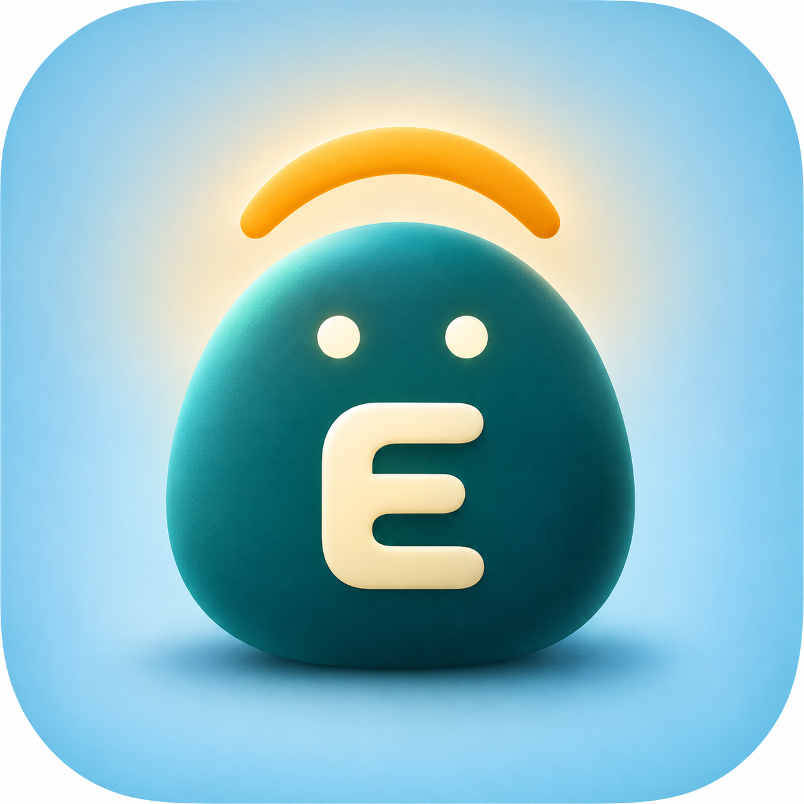
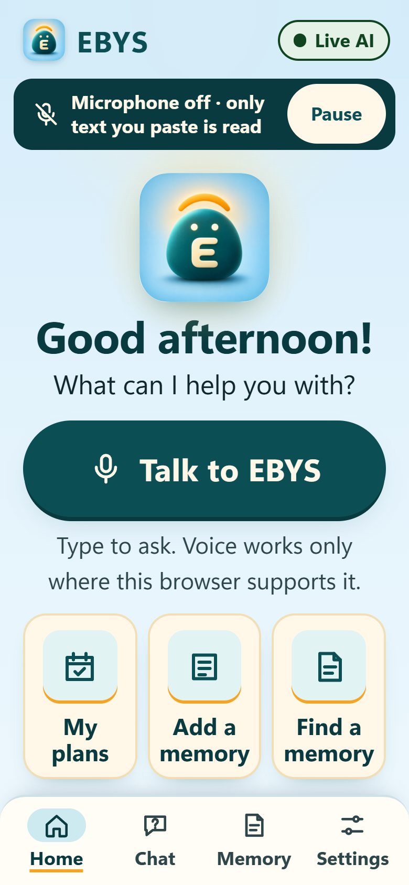

<p align="center">
  
</p>

# EBYS · Ever by your side

**A conversation memory for older adults that answers from the words that were actually said, and saves a plan only after you confirm it.**

EBYS is a mobile-first web app. You paste a conversation and ask a plain question: who, when, where. A real language model answers, and every answer comes with the exact quote it is based on. If a fact is missing, EBYS says so instead of guessing. If a time could be morning or evening, it asks "AM or PM?".

Built at c0mpiled-17 (Seoul, 2026-11-09, 10:00-15:00 KST). **All demo data is synthetic.**

<p align="center">
  
</p>
<p align="center"><em>Home screen of the live app (390x844 viewport, headless browser capture).</em></p>

## What works today

These are the capabilities that have been tested and recorded in this repository.

| Capability | Status | Evidence |
| --- | --- | --- |
| Typed English conversation in, structured memory out | Works | `evidence/lead-live-en-*.json` |
| Real model: Cursor CLI, Claude Sonnet 5.5 (`claude-sonnet-5-5-low`) | Works, uncached calls recorded | `telemetry` in `/api/ingest` and `/api/query`; QA `9/9` |
| Every answer tied to a verbatim source quote | Works | QA targeted retest |
| Missing facts answered with "I don't have that" | Works (3/3 absent-fact cases) | `qa/evidence/targeted-local-2026-11-09T04-42-20-836Z-180200/REVIEW.md` |
| Ambiguous time asks "Is that AM or PM?", and no time is stored until you choose | Works (2/2 cases) | same QA review |
| Preview, then explicit Confirm or Cancel | Works | `app/flow.test.mjs`, QA review |
| Confirmed event saved to the **EBYS calendar on this PC** (a local JSON file) and read back through the API | Works when started with `EBYS_CALENDAR=local` (QA: 18/18 checks) | QA review, `evidence/lead-calendar-local-*.json` |
| English by default, Korean optional, times shown in Seoul time (UTC+9) | Works | `ui/DESIGN-SKILL-EVIDENCE.md` |

## What it does not do

Please read this before judging the demo.

- **No phone integration.** The calendar is a JSON file on the computer that runs EBYS. It is not the Android or iOS calendar, and nothing is sent to a phone.
- **No OS notifications.** Reminders appear only inside the app (`GET /api/notifications`).
- **No voice acceptance.** Browser speech input and read-aloud are optional, depend on the browser, and were not verified on real devices. Typed input is the tested path.
- **No real calls, messages, emergency calling, safety monitoring, watch, glasses or 24-hour audio.** These are roadmap ideas only. EBYS never calls 119.
- **Not a medical or safety product.**
- The default calendar mode is `simulated`: it saves nothing outside the app and says so on screen.

## Screens

The bottom bar has four tabs.

| Tab | What it is |
| --- | --- |
| **Home** | Mascot, greeting, **Talk to EBYS**, and three shortcuts: **My plans**, **Add a memory**, **Find a memory** |
| **Chat** | Type a question. The answer shows who, when and where with a source for each |
| **Memory** | Remembered items, each with its source quotes |
| **Settings** | Language, privacy and what this build can and cannot do |

A pill at the top shows the mode: **Live AI** means a real model call, and **Sample · not real AI** means the offline fixture.

## Run it

You need **Node.js 24 or newer**. There is nothing to install: the project has no dependencies.

```bash
npm test      # offline unit and integration tests, no model calls
npm start     # http://127.0.0.1:8787/
```

Open `http://127.0.0.1:8787/`. It redirects to `/?api=live`.

- **Live mode** (`/?api=live`) calls a model. It needs the **Cursor CLI installed and already signed in** on the same machine. EBYS runs it in read-only ask mode. A model call takes roughly 20-140 seconds, and the app shows the wait.
- **Fixture mode** (`/?api=fixture`) is a scripted offline sample. It makes no model call and is labelled "Sample · not real AI". Use it to look at the design, not to judge answers.
- If no model answers, EBYS falls back to labelled rules and says so.

To save confirmed plans to the local EBYS calendar file:

```bash
# PowerShell
$env:EBYS_CALENDAR = "local"; npm start
# macOS / Linux
EBYS_CALENDAR=local npm start
```

The file is `.data/calendar.json` (git-ignored). `EBYS_CALENDAR_FILE` changes the path. Full steps and environment variables are in [`docs/SETUP.md`](docs/SETUP.md).

## Demo

A step-by-step walkthrough with synthetic text is in [`docs/DEMO.md`](docs/DEMO.md).

**Demo video:** [Watch the submitted 90-second prototype demo](https://www.youtube.com/watch?v=_Ante-RR464).

The video uses synthetic conversation data and narration, shortens AI waiting time by 20 seconds, and demonstrates the EBYS local calendar on the host computer. Phone operation, Kakao retrieval and phone notifications are not demonstrated.

## How a plan gets made

1. You paste a conversation and give consent. The model extracts memories, each with verbatim quotes.
2. You ask a question. The answer must point to a quote, or EBYS says it does not have it.
3. You choose "Make it a plan?". If the time is ambiguous, EBYS asks for AM or PM and does not preselect one.
4. EBYS shows a preview of exactly what will be saved.
5. You confirm. Only then is the event written, and it is read back to check it. If the source conversation was cancelled or changed, Confirm is refused.

## Repository layout

| Path | What |
| --- | --- |
| `core/` | Extraction, recall, supersede and cancel, proposals, deletion |
| `adapters/` | Previews, confirm ledger, simulated and local calendar, ICS handoff |
| `ui/` | Mobile web app (ES modules, no framework) |
| `app/`, `server.mjs`, `llm/`, `contracts/` | Integration, HTTP server, model route, shared contracts |
| `qa/`, `acceptance-123/` | Independent held-out and live evaluations |
| `evidence/`, `media-outbox/` | Run evidence and capture tooling |
| `docs/` | Setup, demo walkthrough and project intro |

## Evidence

- `qa/evidence/targeted-local-2026-11-09T04-42-20-836Z-180200/REVIEW.md`: independent retest. Five query cases and one local-calendar event passed, with real `cursor-cli / claude-sonnet-5-5-low` calls, uncached, with raw model JSON retained. This is API and file evidence, not full browser or device acceptance.
- `evidence/lead-live-en-2026-11-09T03-51-56-985Z.json`: a new English conversation, five calls, all `mode=model`.
- `evidence/lead-calendar-local-2026-11-09T04-28-35-405Z.json`: a confirmed event written and read back.

## Known limits

- The UI is still being polished during the event, so screens may differ from the screenshot above. The latest full live model run through the new UI is still owed.
- An English readback can repeat a name (for example "with Kai with Kai"). This is a copy issue, not a data error.
- A saved event's `sessionId` is currently `null`, so per-session purge may not remove its calendar entry. QA flagged this for follow-up and did not test deletion.
- Tested in desktop Chrome with mobile emulation, not on real phones, iOS Safari or a screen reader.
- Security and privacy review is not finished. Nothing here should be read as a claim that those issues are resolved.

## Provenance

The event rules allow forks and score only new work. [`REUSE-MANIFEST.md`](REUSE-MANIFEST.md) lists which ideas were adapted from the team's earlier Jarvis prototypes (read-only inspection, no secrets or personal data copied) and what was built in the event window. Commits begin on 2026-11-09.

## License

MIT
